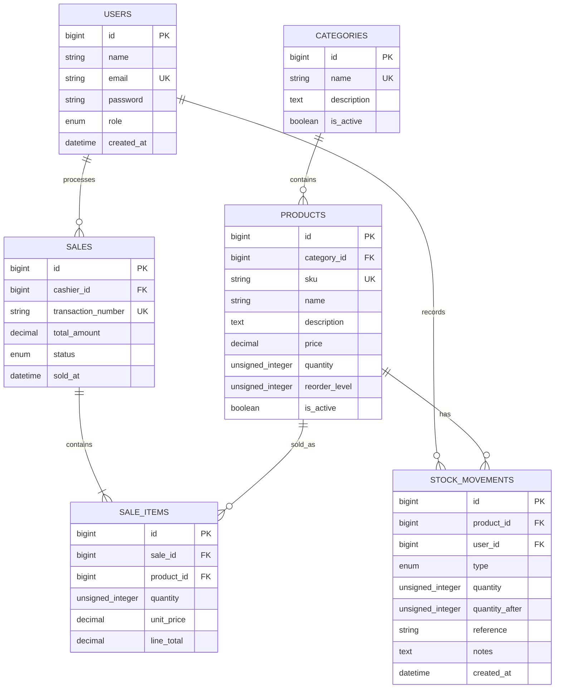

# Motorcycle Parts Inventory and Sales Management System

## Recommended architecture

A two-application monorepo keeps the Vue client and Node.js REST API independently testable with a local SQLite database.

- `frontend`: Vue 3 + Vite single-page application, Tailwind CSS, Vue Router, Axios, Chart.js.
- `backend`: Node.js REST API, JWT bearer authentication, SQLite schema initialization, Zod validation, and Express middleware.
- `docs`: scope, ERD, wireframes, test plans, revisions, and user guide.
- `backend/data`: generated SQLite database files are local runtime data and are ignored by Git.

Request flow: Vue page -> Axios API client -> Express route -> validation and auth middleware -> SQLite service -> JSON response.

## Folder structure

```text
/
|-- frontend/
|   |-- src/
|   |   |-- assets/
|   |   |-- components/       # reusable UI pieces
|   |   |-- layouts/          # authenticated shell and auth layout
|   |   |-- pages/            # Login, Dashboard, Products, Inventory, POS, Reports, Users
|   |   |-- router/            # route definitions and guards
|   |   |-- services/          # Axios client and API modules
|   |   |-- stores/            # auth and UI state when needed
|   |   |-- App.vue
|   |   |-- main.js
|   |   `-- style.css
|   |-- vite.config.js
|   `-- package.json
|-- backend/
|   |-- src/server.js
|   |-- src/db.js
|   |-- src/auth.js, validation.js
|   |-- data/                      # generated SQLite database
|   |-- package.json
|   `-- .env.example
|-- docs/
|   |-- PHASE-2-ARCHITECTURE.md
|   |-- ERD.md
|   `-- wireframes.md
`-- README.md
```

## Database / ERD



Inventory is derived from the product quantity plus an immutable stock movement history. Stock-in adds quantity; stock-out and a successful sale subtract quantity. POS writes the sale, sale items, product quantity, and sale stock movements inside one database transaction, and rejects insufficient stock before any write.

## Vue pages and components

Pages: `Login`, `Dashboard`, `Products`, `Categories`, `Inventory`, `StockMovements`, `POS`, `SalesHistory`, `Reports`, and `Users`.

Reusable components: `AppShell`, `Sidebar`, `Topbar`, `StatCard`, `DataTable`, `StatusBadge`, `FormModal`, `ProductSearch`, `CartPanel`, `EmptyState`, and `ConfirmDialog`.

## Node.js API structure

- `POST /api/auth/login`, `POST /api/auth/logout`, `GET /api/auth/me`
- `GET|POST|PUT|DELETE /api/products`
- `GET|POST|PUT|DELETE /api/categories`
- `GET /api/inventory`, `GET /api/stock-movements`, `POST /api/stock-movements`
- `POST /api/sales`, `GET /api/sales`, `GET /api/sales/{sale}`
- `GET|POST|PUT|DELETE /api/users` (admin only)
- `GET /api/reports/sales`, `GET /api/reports/inventory`

Validation belongs in Zod schemas, authorization in Express middleware, and multi-table inventory/sale updates execute inside SQLite transactions.

## Authentication and roles

JWT authenticates a user after login and returns a token for the Axios client. The frontend stores only the token and basic user profile in session storage, sends `Authorization: Bearer <token>`, and redirects unauthenticated users to Login.

- Admin: products, categories, inventory, stock movements, reports, users, and sales.
- Staff: products/inventory lookup, stock movements as authorized, POS, own sales history, and reports allowed by policy.

Passwords are hashed with bcrypt. No passwords or tokens are logged or committed.

## Phase 2 TODO checklist

- [x] Confirm scope, roles, deliverables, and acceptance criteria.
- [x] Scaffold Vue 3 + Vite frontend.
- [x] Scaffold Node.js REST backend.
- [x] Install Tailwind CSS, Axios, Vue Router, Chart.js, and Node API dependencies.
- [x] Initialize monorepo folder structure and architecture notes.
- [x] Create initial database/ERD design.
- [x] Create responsive login/navigation/dashboard/POS/inventory wireframe prototype.
- [x] Add SQLite schema, models, seed accounts, and role middleware.
- [x] Connect the login prototype to the Node.js JWT API.
- [x] Initialize the local database and validate the inventory and sales workflow.

## Development commands

From the repository root:

```powershell
cd frontend
npm install
npm run dev

cd ..\backend
npm install
Copy-Item .env.example .env
npm run dev
```

The frontend already defaults to `VITE_API_BASE_URL=http://127.0.0.1:8000/api`. Copy `backend/.env.example` to `backend/.env` to customize the port, JWT secret, SQLite file, or frontend origin.
